<p align="center">
  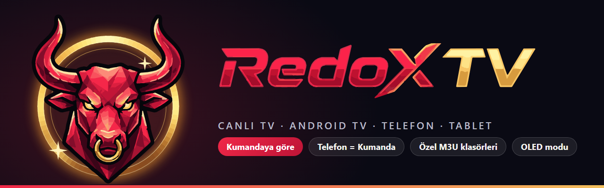
</p>

<p align="center">
  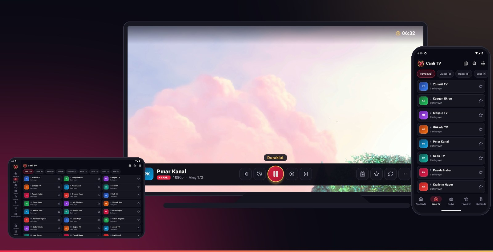
</p>

<h1 align="center">RedoX TV 2</h1>

<p align="center">
  <b>Android TV, tablet ve telefon için canlı TV oynatıcı.</b><br>
  Yalnızca yön tuşlarıyla rahat kullanım · ekranın %15'ini kaplayan tek satırlık oynatıcı çubuğu · hazır, denenmiş kanal listesi · kendi M3U / Xtream listeleriniz klasör klasör.
</p>

<p align="center">
  <a href="https://github.com/ByReoxXx/RedoX-TV-2/releases/latest"></a>
  <a href="https://github.com/ByReoxXx/RedoX-TV-2/actions/workflows/build.yml"></a>
  
  
  
  
</p>

<p align="center">
  <a href="https://github.com/ByReoxXx/RedoX-TV-2/releases/latest"><b>⬇️ İndir</b></a> &nbsp;•&nbsp;
  <a href="https://github.com/ByReoxXx/RedoX-TV-2/wiki"><b>📖 Wiki</b></a> &nbsp;•&nbsp;
  <a href="https://github.com/ByReoxXx/RedoX-TV-2/issues">🐞 Hata / öneri</a>
</p>

---

## ✨ Neden RedoX TV 2?

<table>
  <tr>
    <td width="33%" valign="top">
      <b>🎮 Kumandaya göre</b><br>
      Chromecast with Google TV kumandası gibi yalnızca yön tuşları, <code>OK</code> ve <code>Geri</code> olan kumandalarla her şey yapılır. Menü, kanal ve rakam tuşu gerekmez.
    </td>
    <td width="33%" valign="top">
      <b>🎛️ Tek satırlık oynatıcı çubuğu</b><br>
      Kanal bilgisi, oynatma ve kısayollar ekranın yalnızca ~%15'inde. Kalite, ses, altyazı, ölçek, gece modu gibi ayarlar <b>Seçenekler</b> menüsünde.
    </td>
    <td width="33%" valign="top">
      <b>📚 Hazır kanal listesi</b><br>
      Türksat'ın şifresiz (TKGS) kanallarıyla eşleşen <b>121 kanal / 398 yayın</b>, tek tek denenmiş. Aynı kanalın alternatif yayınları tek kanalda; liste açılışta kendiliğinden güncellenir.
    </td>
  </tr>
  <tr>
    <td valign="top">
      <b>📁 Özel M3U klasörleri</b><br>
      Eklediğiniz her liste, verdiğiniz adla bir klasör olur. M3U adresi, dosya, Xtream Codes ya da telefondan QR ile ekleyin.
    </td>
    <td valign="top">
      <b>📲 Telefon = kumanda</b><br>
      Telefon TV'yi ağda bulur, ekrandaki 6 haneli kodla eşleşir; yön tuşları, ses, rakamlar ve <b>"TV'de oynat"</b> telefonda.
    </td>
    <td valign="top">
      <b>🌙 Hafif ve gözü yormayan</b><br>
      Sade efektler, OLED modu (saf siyah), altın odak halkası. Zayıf TV işlemcilerinde de akıcı kalması için sonsuz animasyon yok.
    </td>
  </tr>
</table>

---

## 🖼️ Ekran görüntüleri

> Görüntüler gerçek uygulamadan, GitHub Actions'taki otomatik emülatör turuyla alınır (`ci/capture.sh`). Oynatıcı görüntülerinde telifsiz demo yayın kullanılır: *Big Buck Bunny* © Blender Foundation, [CC BY 3.0](https://creativecommons.org/licenses/by/3.0/).

### 📺 Android TV

<table>
  <tr>
    <td width="50%">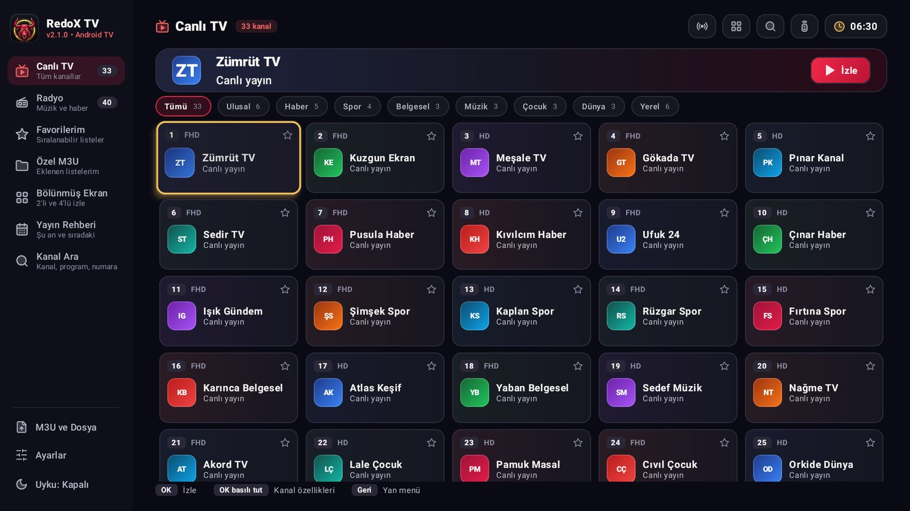<br><sub><b>Canlı TV</b> — kanal vitrini, kategori çipleri, 121 kanal</sub></td>
    <td width="50%">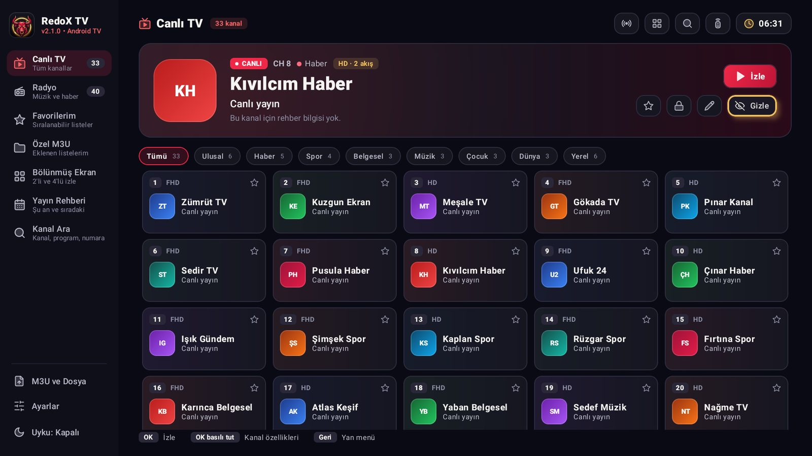<br><sub><b>Kanal özellikleri</b> — <code>OK</code> basılı tut: izle, favori, kilit, düzenle, gizle</sub></td>
  </tr>
  <tr>
    <td>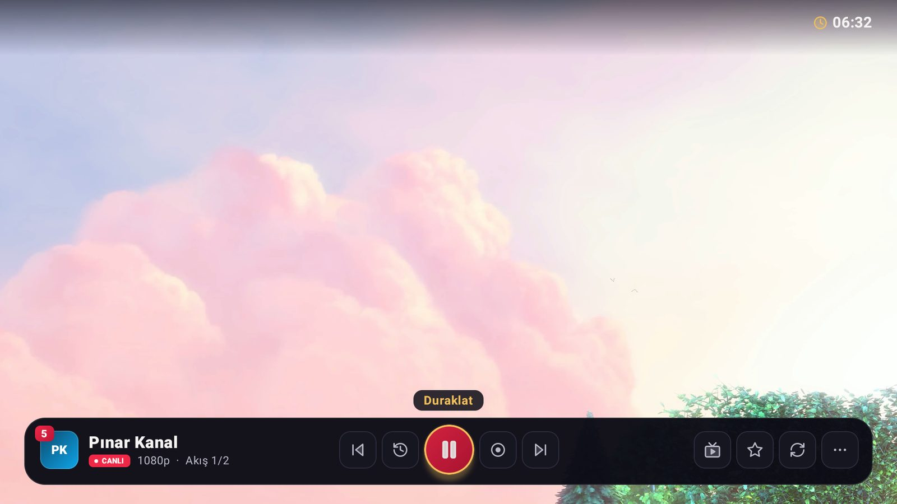<br><sub><b>Oynatıcı çubuğu</b> — kanal, oynatma düğmeleri ve kısayollar tek satırda</sub></td>
    <td>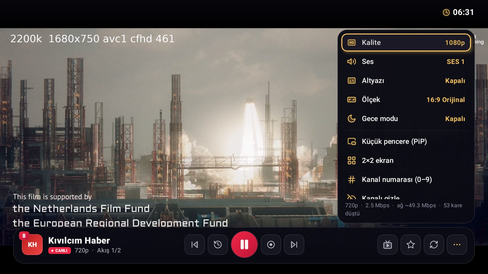<br><sub><b>Seçenekler</b> — kalite, ses, altyazı, ölçek, gece modu, PiP, 2×2…</sub></td>
  </tr>
  <tr>
    <td>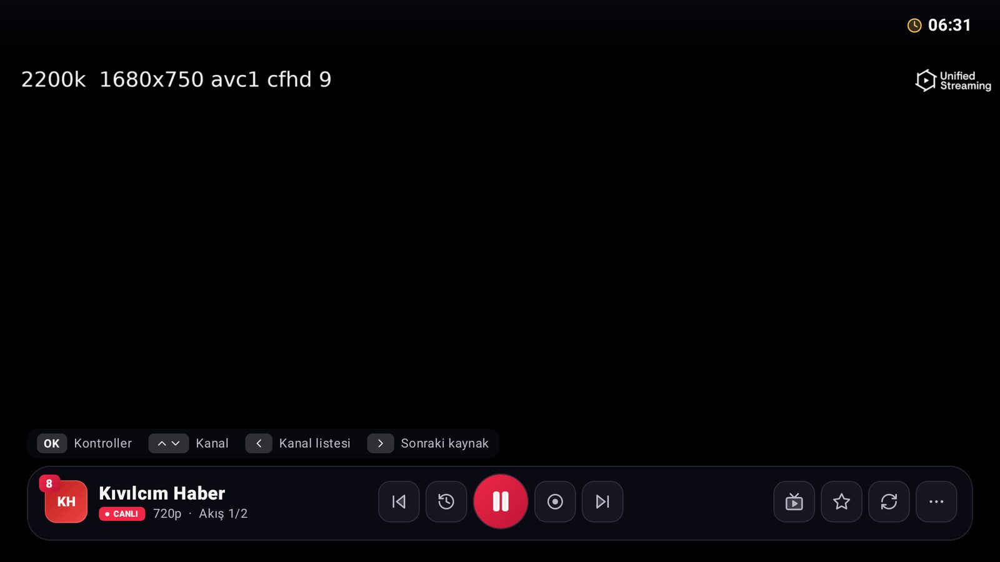<br><sub><b>Kanal değişince</b> — çubuk ve kısayol ipuçları kısa süre görünür</sub></td>
    <td>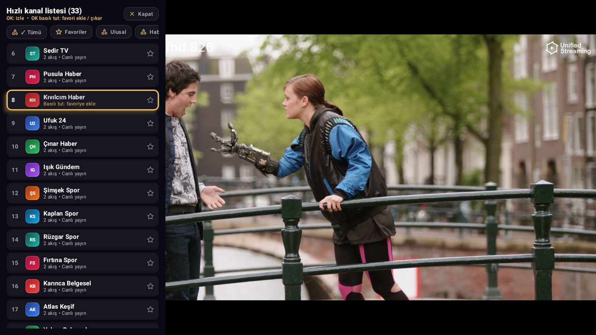<br><sub><b>Hızlı kanal listesi</b> — oynatıcıda <code>◄</code></sub></td>
  </tr>
  <tr>
    <td>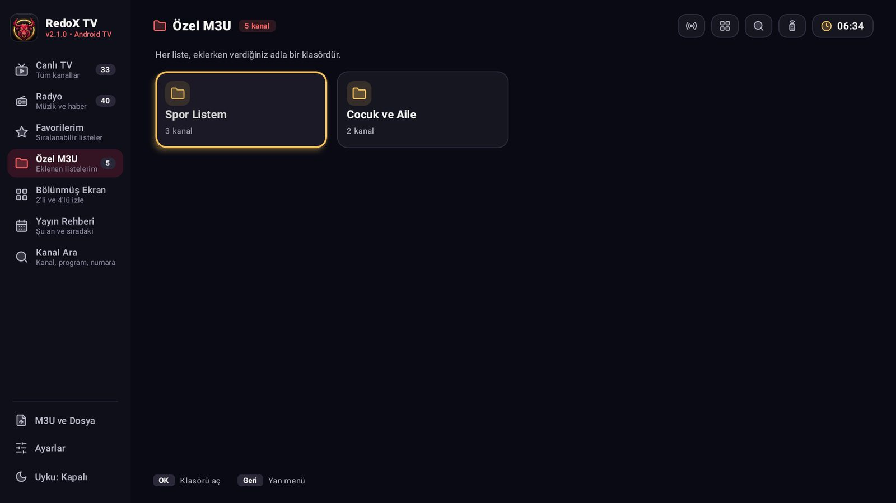<br><sub><b>Özel M3U</b> — her liste, verdiğiniz adla bir klasör</sub></td>
    <td><br><sub><b>Favorilerim</b> — sıralanabilir listeler</sub></td>
  </tr>
  <tr>
    <td>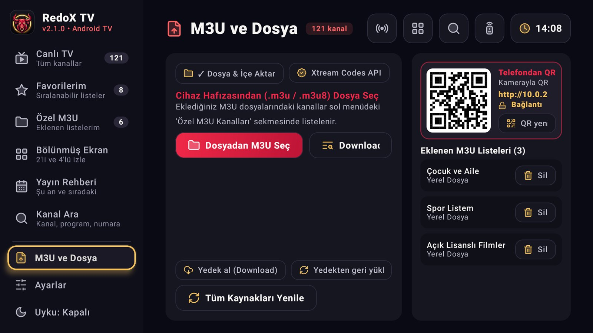<br><sub><b>M3U ve Dosya</b> — dosya, Xtream, QR ile telefondan ekleme</sub></td>
    <td>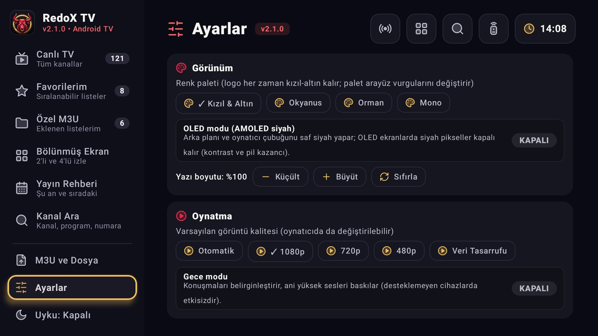<br><sub><b>Ayarlar</b> — palet, OLED modu, yazı boyutu, kalite, gece modu</sub></td>
  </tr>
</table>

### 📱 Telefon

<table>
  <tr>
    <td width="20%">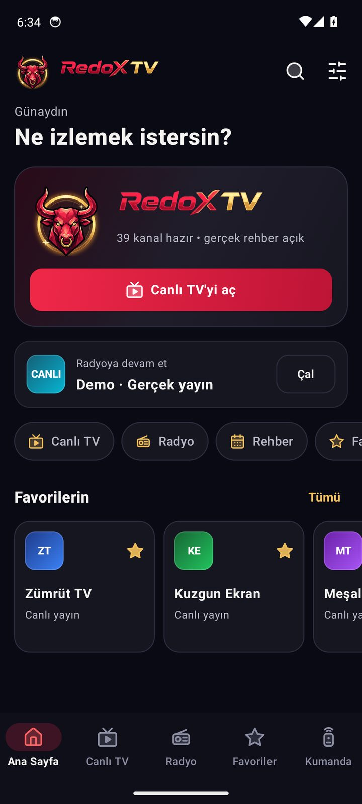<br><sub><b>Ana sayfa</b></sub></td>
    <td width="20%">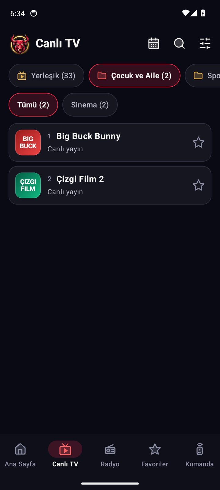<br><sub><b>Canlı TV</b> + klasör çipleri</sub></td>
    <td width="20%">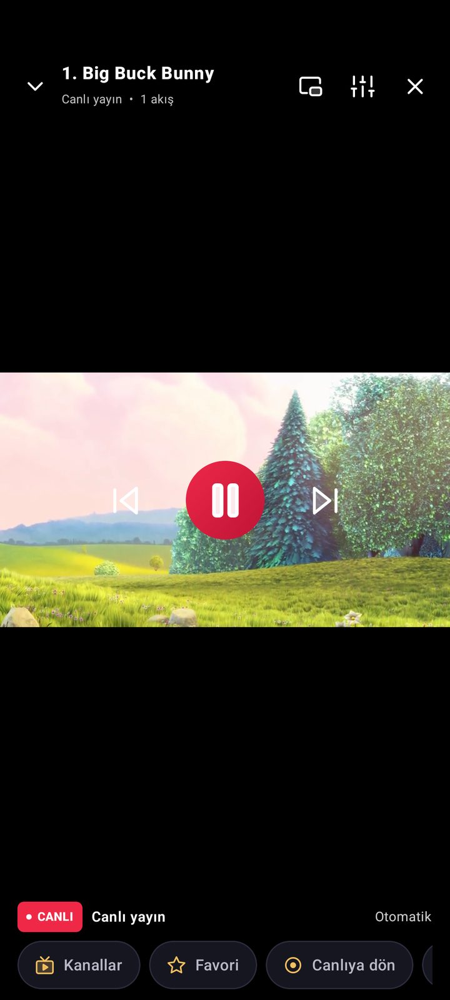<br><sub><b>Oynatıcı</b></sub></td>
    <td width="20%">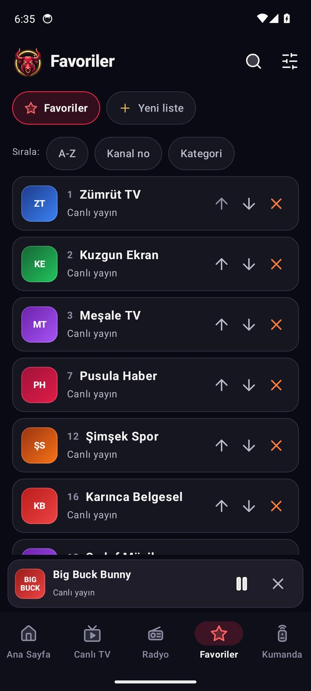<br><sub><b>Favoriler</b></sub></td>
    <td width="20%">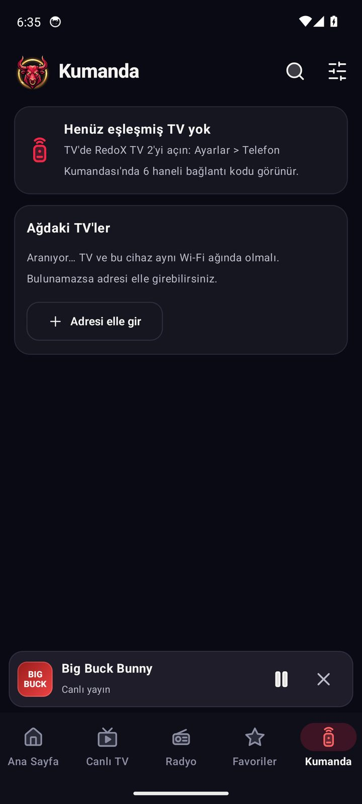<br><sub><b>TV kumandası</b></sub></td>
  </tr>
</table>

### 💻 Tablet

<table>
  <tr>
    <td width="50%">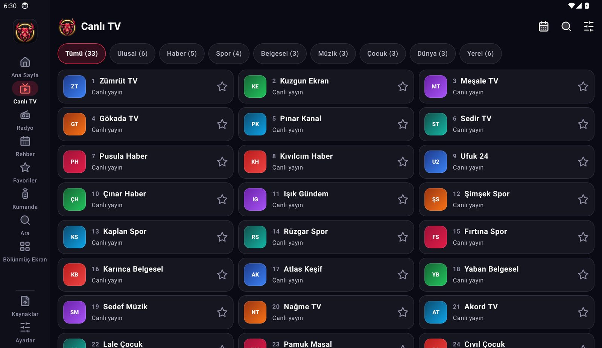<br><sub><b>Canlı TV</b> — gezinti rayı, çok sütunlu ızgara</sub></td>
    <td width="50%">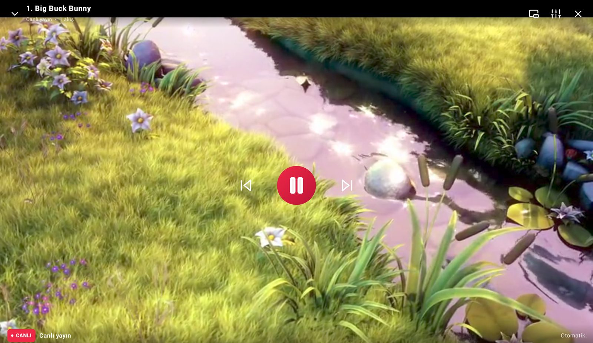<br><sub><b>Oynatıcı</b> — dokun: kontroller, çift dokun: duraklat</sub></td>
  </tr>
</table>

Tüm görüntüler ve ayrıntılar: [📸 Wiki → Ekran Görüntüleri](https://github.com/ByReoxXx/RedoX-TV-2/wiki/Ekran-Goruntuleri).

---

## 🚀 Hızlı başlangıç

**1. İndirin.** [Releases](https://github.com/ByReoxXx/RedoX-TV-2/releases/latest) sayfasından cihazınıza uygun APK'yı alın:

| APK | Cihaz | Arayüz |
|---|---|---|
| `RedoX-TV-2-v2.1.0-tv.apk` | Android TV, Google TV, TV Box | Kumanda (D-Pad) odaklı "lean-back" arayüz |
| `RedoX-TV-2-v2.1.0-tablet.apk` | Tabletler | Gezinti rayı, geniş ızgaralar, yan yana bölünmüş ekran |
| `RedoX-TV-2-v2.1.0-phone.apk` | Telefonlar | Alt gezinti, mini oynatıcı, hareketler — aynı zamanda **TV kumandası** |

**2. Kurun.** Telefon/tablette APK'ya dokunun ("bilinmeyen kaynaklardan yükleme"ye izin verin). Android TV'de USB bellek, *Downloader* uygulaması ya da `adb` ile:

```bash
adb connect <TV-IP>:5555
adb install -r RedoX-TV-2-v2.1.0-tv.apk
```

**3. İzleyin.** Açılışta 121 kanal hazırdır: `OK` ile izleyin, `OK` basılı tutarak kanal özelliklerine (favori, kilit, düzenle, gizle) gidin. Oynatıcıda `OK` çubuğu açar, `◄` kanal listesini, `►` bir sonraki yayın kaynağını, `▲ ▼` kanal değiştirmeyi yapar.

**4. Kendi listenizi ekleyin.** TV'de **M3U ve Dosya** (ya da telefonda **Kaynaklar**): M3U adresi, dosya, Xtream Codes veya QR ile telefondan gönderme. Listeler **Özel M3U** sekmesinde, verdiğiniz adla klasör olur.

> ⚠️ **Kurulum notu:** APK'lar her derlemede yeniden üretilen bir debug anahtarıyla imzalanır; bu yüzden **v2.0.0 kuruluysa önce onu kaldırın** (önce *M3U ve Dosya → Yedek al* ile yedek alabilirsiniz). Sabit imza anahtarı eklenirse sonraki sürümler üzerine kurulur → [Kurulum Rehberi](https://github.com/ByReoxXx/RedoX-TV-2/wiki/Kurulum-Rehberi).

---

## 🎮 Kumanda haritası

**Android TV** — yalnızca yön tuşları, `OK` ve `Geri` olan kumandalarla tam çalışır.

| Ekran | Tuş | İşlev |
|---|---|---|
| Kanal ızgarası | `OK` / `OK` basılı tut | İzle / odağı üstteki panele (İzle, Favori, Kilit, Düzenle, Gizle) götür |
| Tüm ekranlar | `Geri` | Bir üst düzeye: listeden kategori çiplerine, çiplerden yan menüye; yan menüde ikinci basış uygulamadan çıkar |
| Oynatıcı | `▲ ▼` | Kanal değiştir |
| Oynatıcı | `◄` / `►` | Kanal listesi / sonraki yayın kaynağı |
| Oynatıcı | `OK` | Alt çubuk: kanal ve program, oynatma düğmeleri, kanal listesi, favori, alternatif yayın, **Seçenekler** |
| Oynatıcı | `0` | Önceki kanal |
| Özel M3U | `OK` / `Geri` | Klasörü aç / klasör listesine dön |
| Favoriler | `►` → `▲ ▼` → `OK` | Kanalı tut, taşı, bırak |

**Telefon / tablet:** kanala dokun = izle, uzun bas = seçenekler (favori, kilit, gizle, düzenle, TV'de oynat). Oynatıcıda sol kenarda dikey kaydır = parlaklık, sağ kenarda = ses, yatay kaydır = kanal değiştir, çift dokun = duraklat/oynat. Ayrıntı: [Kumanda ve Dokunmatik Kontroller](https://github.com/ByReoxXx/RedoX-TV-2/wiki/Kumanda-ve-Dokunmatik-Kontroller).

---

## 📚 Kanal listesi nasıl çalışır?

- Yerleşik liste `channel/channels.enc` dosyasındadır (AES-256 şifreli JSON). Uygulama her açılışta bu dosyayı bu depodan indirip yeniler; internet yoksa son indirilen ya da APK içindeki kopya kullanılır. Böylece kanal listesi, **uygulamayı güncellemeden** düzelebilir.
- Liste, Türksat'ın resmi frekans listesindeki **şifresiz (TKGS)** kanallarla eşleşen ve çalışan yayını olan kanallardan oluşur; sıra Türksat frekans listesine göre dizilidir. Aynı kanalın tekrarları tek kanalda **alternatif akış** olarak birleştirilmiştir; bir akış açılmazsa uygulama kendiliğinden sıradakine geçer.
- Dilerseniz kendi M3U / Xtream listelerinizi eklersiniz; yerleşik liste yerine değil, yanında durur.

Ayrıntı: [Wiki → Kanal Listesi](https://github.com/ByReoxXx/RedoX-TV-2/wiki/Kanal-Listesi).

---

<details>
<summary><b>🧩 Tüm özellikler</b></summary>

### Her üç cihazda
- **Gerçek yayın rehberi (XMLTV) ve hatırlatıcılar.** XMLTV adresi (`.xml` / `.xml.gz`) eklenir; M3U listelerinizdeki rehber adresleri de otomatik kullanılır. Kanallar rehberle `tvg-id` ve ad benzerliğiyle eşleşir. *Uydurma program adı gösterilmez:* rehberi olmayan kanalda yalnızca "Canlı yayın" yazar. Programa dokunarak hatırlatma eklersiniz.
- **Kalite seçici, gerçek istatistikler, gece modu.** Otomatik / 1080p / 720p / 480p / Veri Tasarrufu. Çözünürlük, bit hızı, ağ tahmini ve düşen kare sayısı **ölçülen** değerlerdir. Gece modu konuşmaları belirginleştirir, ani yüksek sesleri baskılar.
- **Arama.** Kanal adı, kategori, numara ve gerçek program adları içinde; küçük yazım hatalarını tolere eder.
- **Akıllı raflar.** "İzlemeye devam et", "En çok izlediklerin", "Favorilerinde şimdi yayında".
- **Çoklu favori listeleri.** İstediğiniz kadar liste; sıralama, yeniden adlandırma, silme. **Kanal adı / numarası düzenleme** (yalnızca bu cihazda, geri alınabilir).
- **Çoklu kaynak ve otomatik yedek akış geçişi**, canlı yayında duraklatma, ebeveyn PIN kilidi, kanal gizleme, 2'li ve 4'lü bölünmüş ekran, uyku zamanlayıcı.
- **Tema.** Kızıl & Altın (varsayılan), Okyanus, Orman, Mono paletleri; OLED modu (saf siyah); yazı boyutu.
- **Güvenlik ve bakım.** Katı TLS, PIN'li yerel sunucu, güncelleme denetimi, dosyaya yedekleme, yerel tanılama günlüğü.

### Android TV
- **Android TV ana ekranı entegrasyonu:** Favori Kanallar satırı ve "Devam et" (Watch Next) — TV'nizin ana ekranı destekliyorsa.
- **Telefon = kumanda sunucusu:** telefon/tablet uygulaması TV'yi ağda bulur, ekrandaki 6 haneli kodla eşleşir.
- QR kodlu web sayfasıyla telefondan M3U / Xtream / yedek gönderimi (kodla korunur).

### Telefon ve tablet
- **Hareketler:** sol kenarda dikey kaydır = parlaklık, sağ kenarda = ses, yatay kaydır = kanal değiştir, çift dokun = duraklat/oynat.
- **Otomatik PiP** ve **arka planda ses** (bildirim ve kilit ekranı kontrolleriyle).
- **Telefon = Kumanda:** yön tuşları, ses, kanal, rakamlar, TV'deki kanal listesi; **"TV'de oynat"** ile telefondaki bir kanalı TV'ye gönderme.
- Tablet: gezinti rayı, çok sütunlu ızgara, yan yana 2'li / 2×2 bölünmüş ekran.

</details>

<details>
<summary><b>🎨 Tasarım dili "Kızıl Halka" ve vektör logo</b></summary>

**RedoX = Red + Ox** — "kırmızı boğa". Logo, kırmızı faset (low-poly) boğa başı, altın halka ve parlayan gözlerden oluşur; "RedoX" kırmızı italik, "TV" altın yazılır. Logo **tamamen vektördür** (`VectorDrawable`): uygulama simgesi (Android 13+ temalı simge dahil), bildirim simgesi, TV afişi ve uygulama içi işaret her ekran yoğunluğunda keskin kalır. SVG dosyaları: [`docs/brand/`](docs/brand).

Arayüz paleti doğrudan logodan ölçülmüştür:

| Renk | Değer | Kullanım |
|---|---|---|
| Kızıl (şarap → mercan) | `#590823` `#96112F` `#BD1436` `#F02848` `#FA6465` | Eylemler, canlı rozeti, seçili öğeler |
| Altın | `#A17844` `#DAA24F` `#F3C05D` `#FDDE7A` | **Odak halkası**, favori yıldızı, ilerleme çubukları |
| Lacivert-siyah | `#0A0A14` `#161621` `#1F1D2A` | Zemin, kart, yükseltilmiş yüzey (OLED modunda saf siyah) |

Logodaki altın halka arayüzün **odak göstergesidir**: TV'de odaktaki öğe 3 dp altın çerçeve ve yumuşak ışımayla belirir; kırmızı yalnızca eylem ve canlı yayın içindir. Ayrıntı: [Tasarım Dili ve Logo](https://github.com/ByReoxXx/RedoX-TV-2/wiki/Tasarim-Dili-ve-Logo).

</details>

<details>
<summary><b>🔒 Güvenlik ve gizlilik</b></summary>

- **Katı TLS (varsayılan).** Yalnızca *yayın akışları*, bölgesel yayıncıların kendinden imzalı sertifikalarını kabul eden ayrı bir istemci kullanır; liste/rehber indirmeleri, güncelleme denetimi ve kanal senkronu sertifikayı doğrular.
- **Yerel sunucu kimlik doğrulaması.** TV'nin web sayfası ve kumanda API'si aynı ağdaki herkese açık değildir: 6 haneli kodla oturum açılır; yanlış kodla 5 denemeden sonra 60 sn beklenir. Kod yalnızca TV'de görünür.
- **Ebeveyn PIN'i** ekranda gösterilmez; yedeğe yazılmaz. `android:allowBackup="false"`.
- **Tanılama günlüğü** yalnızca cihazdadır; paylaşmak sizin elinizdedir. Hiçbir veri otomatik gönderilmez. Güncelleme denetimi yalnızca GitHub'daki en son sürüm numarasını okur.

Ayrıntı: [Güvenlik ve Gizlilik](https://github.com/ByReoxXx/RedoX-TV-2/wiki/Guvenlik-ve-Gizlilik).

</details>

<details>
<summary><b>🛠️ Geliştiriciler için</b></summary>

Bilgisayarınıza Android Studio / JDK / SDK kurmanız **gerekmez**; derleme GitHub Actions'ta yapılır.

1. Depoyu kendi hesabınıza çatallayın ya da yeni bir depoya yükleyin.
2. **Actions** sekmesinde *RedoX TV 2 - APK derle* çalışır; bitince **Artifacts** altında üç APK görünür.
3. **Release için:** `git tag v2.1.0 && git push origin v2.1.0`. APK'lar Releases sayfasına yüklenir; uygulamadaki güncelleme denetimi bu sayfaya bakar. Sürüme özel "Yenilikler" metni `.github/release-notes/<etiket>.md` dosyasından eklenir.
4. **Sabit imza anahtarı** için `REDOX_KEYSTORE_BASE64`, `REDOX_KEYSTORE_PASSWORD`, `REDOX_KEY_ALIAS`, `REDOX_KEY_PASSWORD` gizli değerlerini ekleyin ([adımlar](https://github.com/ByReoxXx/RedoX-TV-2/wiki/Kurulum-Rehberi)).
5. `ui-*` dallarına her push'ta telefon, tablet ve Android TV emülatörlerinde uygulama açılıp gezilir, ekran görüntüleri alınır (`ci/capture.sh`); görüntüler `shots-phone` / `shots-tablet` / `shots-tv` dallarına yüklenir.

```text
app/src/
├── main/    ortak çekirdek: veri, ViewModel, oynatıcı fabrikası, tasarım sistemi, ağ ve özellik merkezi
├── tv/      Android TV arayüzü (kumanda odaklı) + TV ana ekranı entegrasyonu
├── mobile/  telefon ve tabletin ortak ekranları, oynatma merkezi, arka plan servisi
├── phone/   telefon iskeleti (alt gezinti, mini oynatıcı)
└── tablet/  tablet iskeleti (gezinti rayı)
```

`app/build.gradle.kts` üç ürün çeşidi (`tv`, `tablet`, `phone`) tanımlar. Teknik ayrıntı: [Teknik Mimari ve Geliştirici Rehberi](https://github.com/ByReoxXx/RedoX-TV-2/wiki/Teknik-Mimari-ve-Gelistirici-Rehberi).

</details>

---

## 🧭 Dürüstlük notları

- **Gerçek cihaz denemesi sınırlıdır.** Kod GitHub Actions'ta derlenir ve emülatörlerde (telefon, tablet, Android TV) otomatik gezilir; ancak gerçek TV / telefon / tablet cihazlarında ve gerçek yayınlarla uzun süreli deneme yapılmadı. Sorun görürseniz [Issues](https://github.com/ByReoxXx/RedoX-TV-2/issues)'a yazın.
- **Yayın rehberi varsayılan olarak boştur.** Gerçek XMLTV verisi yoksa arayüz program adı uydurmaz; rehber için Ayarlar'dan bir XMLTV adresi eklemeniz gerekir.
- **Ağ bit hızı** yalnızca ExoPlayer'ın ölçtüğü tahmindir; kaynağın gerçek kapasitesi değildir.
- **Android TV ana ekranı**, **PiP** ve **arka plan sesi** üreticiye / Android sürümüne göre küçük farklar gösterebilir.
- APK imzası sabit değildir (yukarıdaki kurulum notu).

## 🙏 Atıflar ve sorumluluk reddi

- **RedoX TV 2 bir oynatıcıdır; içerik barındırmaz veya sağlamaz.** Yerleşik liste, internette herkese açık yayın adreslerine işaret eder. Yayınların telif ve erişim koşulları ilgili yayıncılara aittir; kullanım sorumluluğu size aittir, lütfen yerel mevzuata uyun.
- Ekran görüntülerindeki demo yayın: *Big Buck Bunny* © Blender Foundation | [www.blender.org](https://www.blender.org), [CC BY 3.0](https://creativecommons.org/licenses/by/3.0/).
- Kullanılan açık kaynak bileşenler: [Jetpack Compose](https://developer.android.com/jetpack/compose), [Media3 / ExoPlayer](https://developer.android.com/media/media3), [Coil](https://coil-kt.github.io/coil/), [OkHttp](https://square.github.io/okhttp/).

Öneri ve hata bildirimleri için **Issues**, katkı için **Pull Requests** bölümlerini kullanabilirsiniz.
